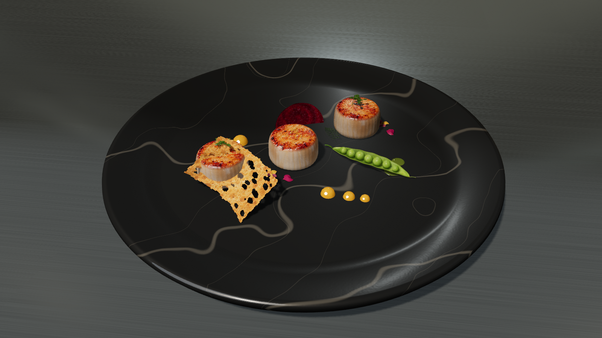
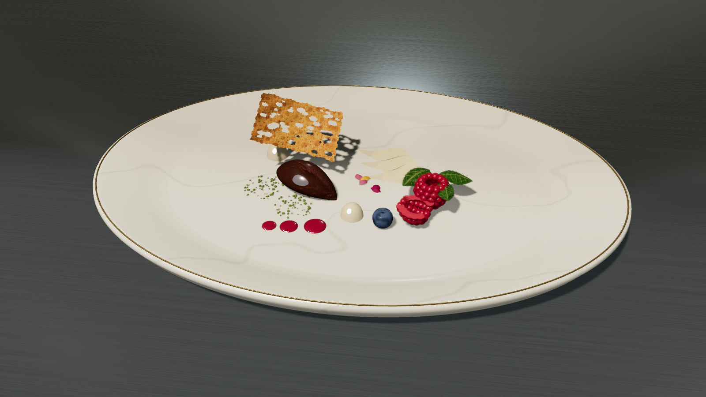
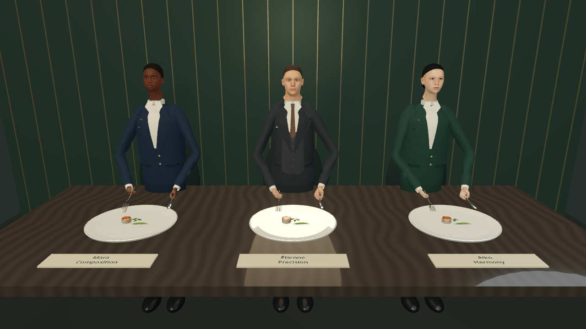

# A Humble Plate

A relaxing 3D fine-dining plating game by [TryamOjageer](https://github.com/TryamOjageer). Arrange starters, mains and desserts, experiment with marble crockery, and refine your presentation through reviewer feedback.

## Play on Windows

**[Download A Humble Plate 0.1.1 — Windows 64-bit ZIP](https://github.com/TryamOjageer/A-Humble-Plate/releases/download/v0.1.1/A-Humble-Plate-Windows-x64.zip)**

[Release notes and downloads](https://github.com/TryamOjageer/A-Humble-Plate/releases/tag/v0.1.1)

1. Download and extract the **entire ZIP**.
2. Open the **A Humble Plate** folder.
3. Double-click **A Humble Plate.exe**. Keep the `.pck` file beside it.

**You do not need Godot or a separate installer.** Playing instructions and credits are included in the ZIP.

Version **0.1.1** fixes prawn bodies, tails and torch contact, improves mushroom cut textures, and removes **Chef's example** so players develop their own arrangements.

## About the prototype

- Starters, mains and desserts with ingredient trays and prepared portions.
- Marble crockery, food positioning and a camera you can orbit and zoom.
- Squeeze-bottle sauces, a blowtorch and presentation feedback.
- Animated kitchen crew, three reviewers, and adjustable background music.

## In-game gallery

Example arrangements made with the current prototype's ingredients and plating controls.

**Seared scallops, citrus and greens on charcoal marble**

**Chocolate, pear and berries on ivory porcelain**

**The reviewers' table**

## Feedback

This is an early development preview. Food materials, characters, scoring and performance are still being refined. Please use this repository's **Issues** page to share feedback or report a problem. For technical problems, include what you were doing, your Windows version and graphics-card model.

The Windows build is for a 64-bit PC with a modern Vulkan-capable graphics device and driver. Final minimum requirements have not been established. Android and browser-play downloads are not included.

Engine and asset credits are available in the game and included with the download.
