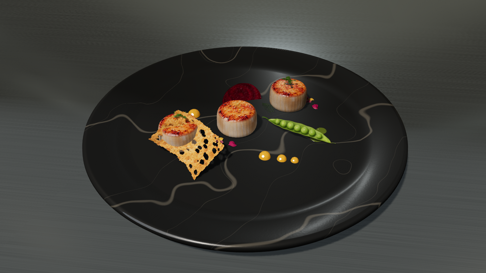
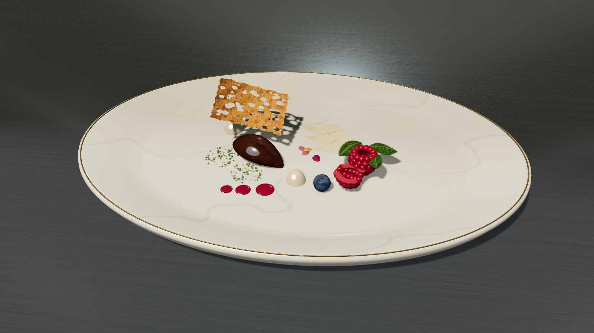
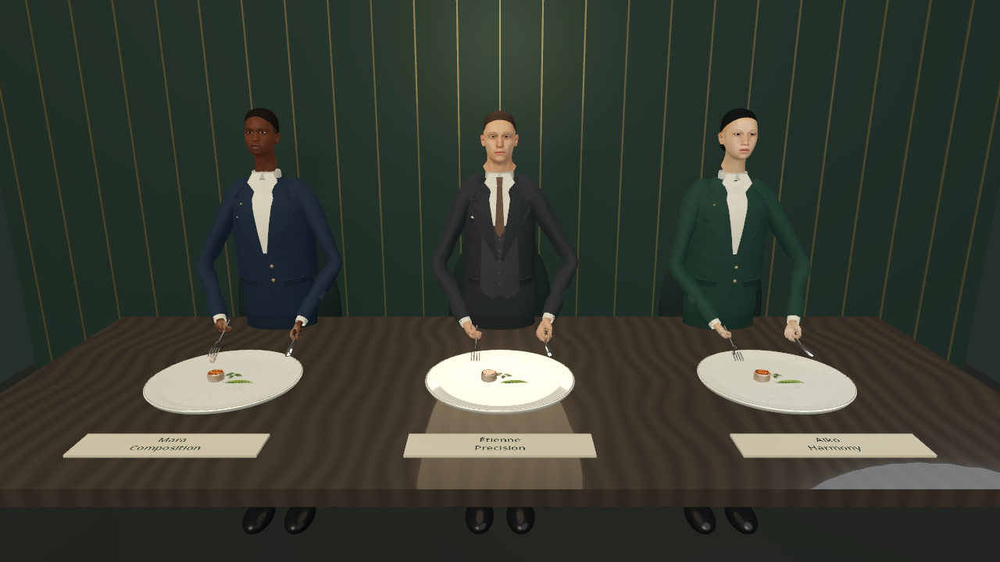

# A Humble Plate

A relaxing 3D fine-dining plating game by [TryamOjageer](https://github.com/TryamOjageer). Arrange starters, mains and desserts, experiment with marble crockery, and refine your presentation through reviewer feedback.

## Play on Windows

**[Download A Humble Plate 0.3.1 — Windows 64-bit ZIP](https://github.com/TryamOjageer/A-Humble-Plate/releases/download/v0.3.1/A-Humble-Plate-Windows-x64.zip)**

[Release notes and downloads](https://github.com/TryamOjageer/A-Humble-Plate/releases/tag/v0.3.1)

1. Download and extract the **entire ZIP**.
2. Open the **A Humble Plate** folder.
3. Double-click **A Humble Plate.exe**. Keep the `.pck` file beside it.

**You do not need Godot or a separate installer.** Playing instructions and credits are included in the ZIP.

Version **0.3.1** adds guest table orders, a walkable restaurant, a six-stage service journey and 180 dish briefs. Pick food directly from ready worktop plates in every mode. The source plates stay put, with no ingredient preparation requests, waiting periods or flying ingredient trays.

To try guest service, open **Guest orders**, seat guests and select a table's ticket. Plate its requested components in your own style, then send the finished dish to that table. The server delivers it and the guests begin eating. Partly plated orders stay saved when switching tables; practice keeps all dishes available.

## About the prototype

- 180 starter, main and dessert briefs, with meat, seafood, vegetarian, vegan and Halaal menu choices.
- Three guest tables with independent three-course orders, presentation feedback and saved plate drafts.
- Walkable kitchen and dining room, seated guests and a server who delivers finished meals.
- Six optional three-course service stages with rising presentation goals and saved personal bests.
- Marble crockery, food positioning and a camera you can orbit and zoom.
- Solid portion resizing, prepared cuts, squeeze-bottle sauces with 2/4/6/8 mm nozzles and a blowtorch.
- Animated kitchen crew, three reviewers, and adjustable background music.

## In-game gallery

Example arrangements made with the current prototype's ingredients and plating controls.

**Seared scallops, citrus and greens on charcoal marble**

**Chocolate, pear and berries on ivory porcelain**

**The reviewers' table**

## Feedback

This is an early development preview. Food materials, characters, scoring and performance are still being refined. Please use this repository's **Issues** page to share feedback or report a problem. For technical problems, include what you were doing, your Windows version and graphics-card model.

The Windows build is for a 64-bit PC with a modern Vulkan-capable graphics device and driver. Final minimum requirements have not been established. Android and browser-play downloads are not included.

Engine and asset credits are available in the game and included with the download.
